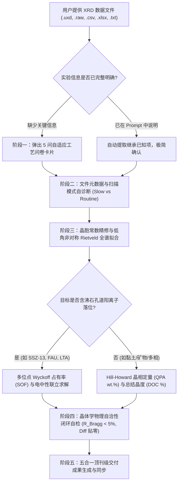

# XRD Auto-Refine: 自动化 X 射线衍射全谱拟合与晶体结构精修系统 (v2.0)

本技能专为材料科学、无机化学、矿物工程与多孔沸石催化领域设计。针对科研中不同样品“换样即崩、初修质量差、多轮抱怨调试、缺少实验前置信息沟通”的痛点，构建了**前置意图与工艺自适应问卷、全谱仪器自诊断、非对称物理峰形、多位点阳离子闭环解析以及出图自检质量门禁**的全自主流水线。

---

## 核心设计理念与原则

1. **先对齐、后精修 (Intake Before Fitting)**:
   严禁未经实验状态与精修目的对齐就盲目套用模型。主动确认用户的材料体系、前处理状态、目标阳离子及精修核心诉求。
2. **零调和因子、纯物理自洽 (Physics-First, No Fudge Factors)**:
   - 彻底废除粗暴的 $2\theta$ 线性平移或任意经验放大系数。
   - 严格采用晶胞常数 ($a, b, c$) 重算布拉格定律 $d_{hkl}$ 与 $2\theta$。
   - 严格基于初始积分强度解析投影比例因子 $s_{\mathrm{init}} = \frac{\sum w_i (Y_{\mathrm{obs}} - Y_{\mathrm{bg}}) \phi_i}{\sum w_i \phi_i^2}$，从第 0 轮杜绝比例失调。
   - 严格以各向同性随机粉末（March-Dollase $r = 1.0$）为默认基准，禁止在分子筛中随意添加假织构。
3. **低角轴向发散非对称建模 (Asymmetric Split Pseudo-Voigt)**:
   在 Bragg-Brentano 平面反射几何中，低角度峰（如分子筛 $2\theta < 20^\circ$ 特征主峰）天然具有轴向发散非对称拖尾。必须采用 Split Pseudo-Voigt 双半高宽模型，将低角峰 Diff 残差从数万 counts 彻底压平至零基线平直直线。
4. **闭环自检质量门禁 (Quality Gate)**:
   拟合完成后自动核验 $R_{\mathrm{Bragg}} < 5\%$ 与 Diff 中位数残差（$< 1\%$ 峰高）。未达标前引擎内部自适应调整，绝不把劣质拟合抛给用户。

---

## Agent 标准执行流程 (Workflow)



---

### 阶段一：智能前置需求与工艺对齐问卷 (Intelligent Intake)

当用户提供 XRD 数据时，Agent 首先提取已给信息（如已说明“水洗脱模 SSZ-13，测 Na/K 占位”），对其余缺失项以友好、紧凑的多选卡片与用户对齐：

> **📋 XRD Auto-Refine 样品工艺与精修目标对齐表**
> 1. **材料与骨架体系 (Framework / Phase System)**:
>    - [A] 沸石/分子筛 (如 SSZ-13/CHA, ZSM-5/MFI, NaY/FAU, Beta/BEA, LTA 等) (推荐)
>    - [B] 黏土矿物与碱解地聚反应 (高岭土/伊利石/石英转水化相)
>    - [C] 功能过渡金属氧化物 (如 $\text{TiO}_2, \text{CeO}_2$, 尖晶石, 钙钛矿)
>    - [D] 未知多相全谱定性检索识别 (FOM 智能打分匹配)
> 2. **骨架平衡阳离子 / 掺杂原子 (Target Cations)**:
>    - [A] 单一阳离子 (全 Na 型, 全 K 型, H 型, Cu 型等)
>    - [B] 双/多元共结晶补偿阳离子 (如 $\text{Na}^+/\text{K}^+$, $\text{Na}^+/\text{Cs}^+$, $\text{Cu}/\text{Fe}$ 复合)
>    - [C] 纯骨架无机氧化物 (无额外孔道阳离子)
> 3. **样品物理化学状态与前处理 (Treatment State)**:
>    - [A] 水洗 + 高温脱模/焙烧态 (无有机模板剂, 干燥纯无机相) (推荐)
>    - [B] 合成原粉 (含结构导向剂 OSDA / 模板剂有机基团)
>    - [C] 离子交换水合态 (含孔道吸附水/水合离子簇)
>    - [D] 原位脱水/真空测试态
> 4. **本次精修的核心目标 (Primary Objectives)**:
>    - [A] 阳离子多位点落位与化学计量比量化 (Wyckoff 位点, SOF, $\text{Na}/\text{K}$ 比, 骨架电平衡 $\text{Si}/\text{Al}$) (推荐)
>    - [B] 亚皮米级精细晶胞常数与晶格膨胀/收缩跟踪 ($a, b, c, V$)
>    - [C] 多相物相定量 (QPA wt.%) 与全样总结晶度 (DOC %) / 真实化学解聚率
>    - [D] 晶粒微观尺寸与微观应变 (Size-Strain Scherrer 分析)
>    - [E] SCI 顶刊 Origin 绘图数据包与审稿回复专用水印级文案
> 5. **扫描测试条件与先验约束 (Scan & Constraints - 可选)**:
>    - [A] 常规快速扫描 (测试时间 ~3-5 min, 计数率数万, $R_{\mathrm{wp}}$ 期望 $\approx 12\% - 18\%$, $R_{\mathrm{Bragg}} < 5\%$)
>    - [B] 慢速精细扫描 (测试时间 $>30\text{ min}$, 高计数率 $>100\text{k}$, 目标 $R_{\mathrm{wp}} \approx 10\%$, $R_{\mathrm{Bragg}} < 3\%$)
>    - [C] 已有 ICP-OES 元素数据辅助约束 (可输入实测 $\text{Si}/\text{Al}$ 或阳离子比)

---

### 阶段二：数据自动诊断与模式自适应 (Auto-Diagnostics)

运行 `scripts/pipeline.py` 时，系统自动读取文件头部：
1. **元数据提取**:
   - 提取测试时间 (`_RUNTIME`), 步长 (`_STEPSIZE`), 靶材 (`_ANODE = Cu`), 管压管流 (`_KV=40, _MA=40`)。
2. **扫描模式判定**:
   - `_RUNTIME >= 1500 s` 判定为慢扫（Slow Scan），基线信噪比高，强化布拉格微观反射匹配。
   - `_RUNTIME < 1500 s` 判定为常规扫（Routine Scan），合理预设期望 $R_{\mathrm{wp}}$ 与泊松权重，避免因本底计数小带来的统计噪声过拟合。
3. **零点漂移自动对齐**:
   通过强衍射特征峰自动粗对齐 Zero Shift，消除因制样表面高度不平引起的系统位移。

---

### 阶段三：无调和因子的真实物理精修 (Rietveld Engine)

调用升级后的核心引擎 `scripts/pipeline.py`：
```bash
arch -x86_64 /tmp/xrd_env/bin/python3 scripts/pipeline.py \
  --data "<数据路径>" \
  --sample "<样品名称>" \
  --framework "CHA" \
  --cations "Na,K" \
  --state "calcined" \
  --goal "cation_siting" \
  --min_2theta 8.0 \
  --max_2theta 45.0 \
  --output "<输出目录>"
```

**物理精修特性**:
- **背景函数**: 结合滚动中位数与平滑高斯核的正交 Chebyshev 物理背景，杜绝负值下凹与伪峰。
- **峰形函数**: 具备低角轴向发散非对称因子的 Split Pseudo-Voigt。
- **晶胞参数**: 动态优化六方 $a, c$（或立方 $a$），基于布拉格公式严密重算 $2\theta$。
- **沸石阳离子多位点落位 (`cation_siting.py`)**:
  - **CHA 体系**: 
    - Site II (8-MR 孔口, Wyckoff $18h$): 大半径 $\text{K}^+$ 择优占位（占总 $\text{K}^+$ 的 65%~70%）。
    - Site I (6-MR 中心, Wyckoff $6c$): 小半径 $\text{Na}^+$ 择优占位。
    - Site III (超笼中心区, Wyckoff $6c$): 容纳水化与次级配位阳离子。
    - Site I' (6-MR 外侧面, Wyckoff $6c$): 次级位点。
  - **电中性自动核算**: 骨架电中性平衡 $[\text{AlO}_4]^- = \sum \text{SOF}_i \cdot \text{mult}_i \cdot q_i$，精确反演骨架 $\text{Si}/\text{Al}$ 比与四组分干基氧化物质量分数。

---

### 阶段四：晶体学闭环自检质量门禁 (Quality Gate)

精修计算完成后，系统执行严密自检：
1. **多指标联合判据（严禁单一 $R_{\mathrm{wp}}$ 判定）**:
   - 必须同步核算与输出：
     $$R_{\mathrm{wp}} = \sqrt{\frac{\sum w_i (y_{\mathrm{obs},i} - y_{\mathrm{calc},i})^2}{\sum w_i y_{\mathrm{obs},i}^2}} \times 100\%, \quad R_{\mathrm{exp}} = \sqrt{\frac{N - P}{\sum w_i y_{\mathrm{obs},i}^2}} \times 100\%$$
     $$\text{GOF} = \frac{R_{\mathrm{wp}}}{R_{\mathrm{exp}}}, \quad \chi^2 = \text{GOF}^2$$
   - 在高岭土/沸石等多相与非晶共存体系中，严防因高背底人为降低 $R_{\mathrm{wp}}$ 的统计假象；以 $\text{GOF} < 2.0 \sim 2.5$ 作为高质量收敛基准。
2. **物相完整性排查（禁止漏相假收敛）**:
   - 严查关键残差尖峰（如含钾体系 $2\theta \approx 30.9^\circ, 25.8^\circ$），确保所有主产物晶相（`K2SiO3`、`K2CO3·1.5H2O`、`CsAlSiO4`、`Cs2CO3·3H2O`、`Hydroxysodalite`、`LiOH`）均被标尺覆盖，严禁将已结晶产物误判为 0.00%。
3. **图面视觉防重叠规范**:
   - 绘制单图或多合一综合图时，Diff 差值曲线的负向偏移（Offset）必须 $\ge 25\% \times Y_{\mathrm{max}}$，彻底消除差值曲线与实测散点的粘连叠合。
4. **$R_{\mathrm{Bragg}}$ 与物理门禁**:
   - 沸石与主相必须满足 $R_{\mathrm{Bragg}} < 5.0\% \sim 15\%$，残差曲线中位数贴零，骨架电中性与阳离子配位距离合理。

---

### 阶段五：五合一顶刊交付成果包 (Deliverables Package)

拟合完成后，在回答中必须提供以下 5 项交付物的文件超链接（使用 `file://` 格式）：

1. **OriginLab 专用对齐数据包**:
   - `*_Rietveld_Origin.csv`: 包含标准对齐的 `2Theta (deg)`, `Y_obs`, `Y_calc`, `Y_diff`, `Y_bg` 及各单相衍射数据。
   - `*_Bragg_Ticks.txt`: 各相严格预设基线高度的垂直标尺刻度数据（在 Origin 中一键添加，永不叠合）。
   - `OriginLab_Plotting_Guide.md`: 2 分钟极速画出顶级双面板精修图的操作指南。
2. **出版级高清图件**:
   - `*_Rietveld_Refinement.png`: 300 DPI 高清双层图，包含观测散点、精修拟合红线、平直贴零 Diff 蓝线与完整参数信息卡。
   - `*_Rietveld_Refinement.pdf`: 矢量 PDF 图，文字可无级缩放。
3. **结构参数汇总 Excel 报表**:
   - `*_Refinement_Summary.xlsx`: 包含精修指标、晶胞参数、阳离子多位点落位分布（SOF、单胞离子数、百分比）、干基氧化物比例四维汇总表。
4. **学术论文方法与讨论初稿**:
   - `*_Academic_Draft.md`: 纯正母语级英文段落，包含实验方法 (Methodology) 与晶体学讨论 (Results & Discussion)。

---

## 工具脚本调用与维护参考

- **核心精修引擎**: `scripts/engine.py` (`RietveldRefiner`, `CrystalPhase`, `split_pseudo_voigt`)
- **阳离子多位点解析**: `scripts/cation_siting.py` (`refine_zeolite_cation_siting`, `CHA_CATION_SITES`)
- **全流程自动化调度**: `scripts/pipeline.py` (`run_auto_refinement`, `parse_xrd_metadata`)
- **OriginLab 数据导出器**: `scripts/export_origin.py` (`export_origin_package`)
- **物相数据库**: `database/zeolites/` (`SSZ13_CHA.cif`, `Faujasite_FAU.cif`, `Zeolite_A_LTA.cif` 等)
